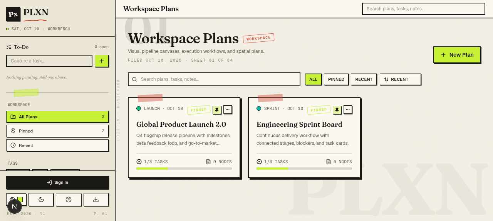
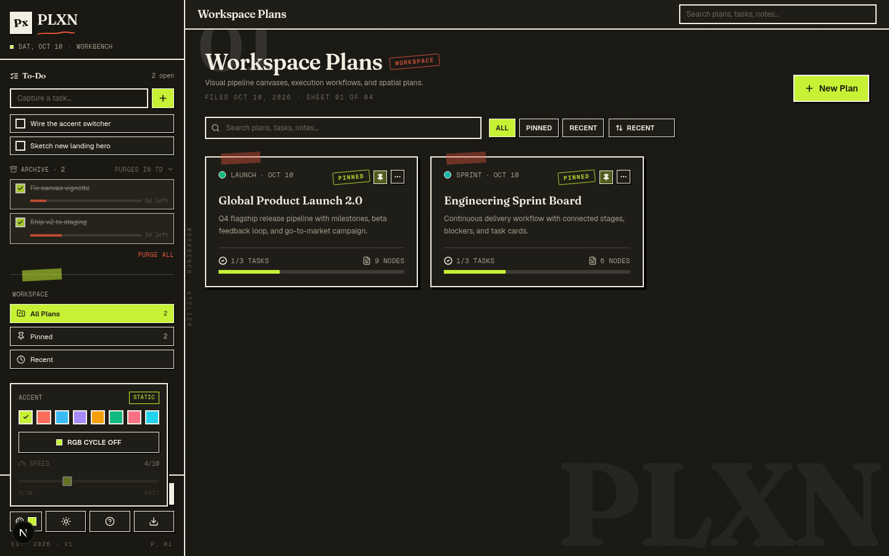
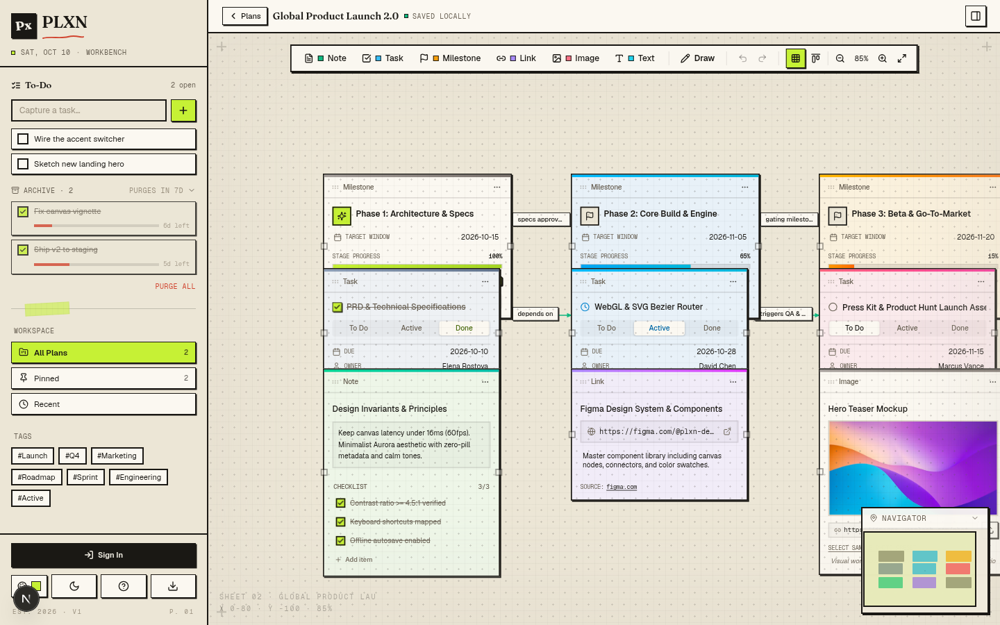
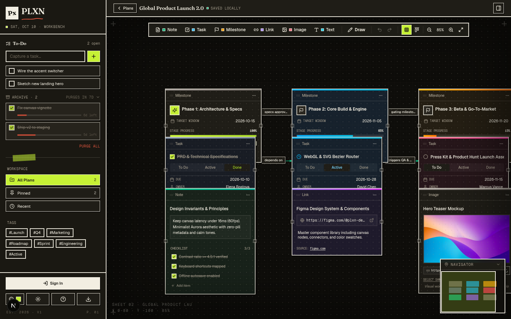
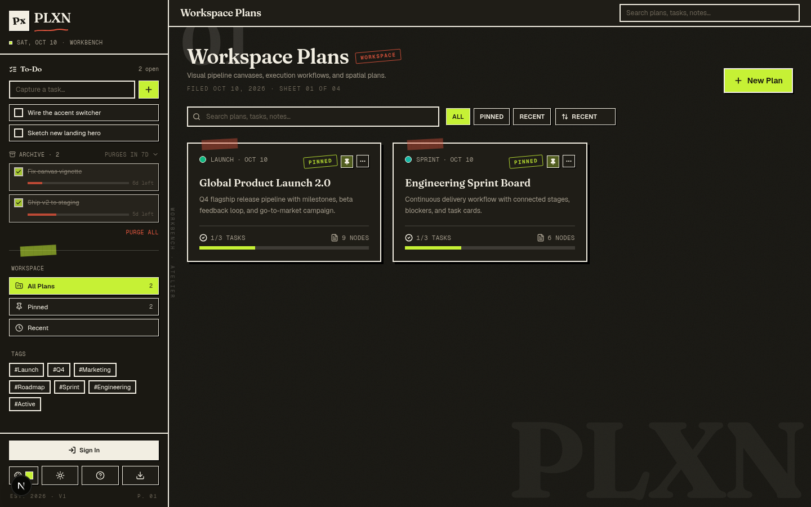
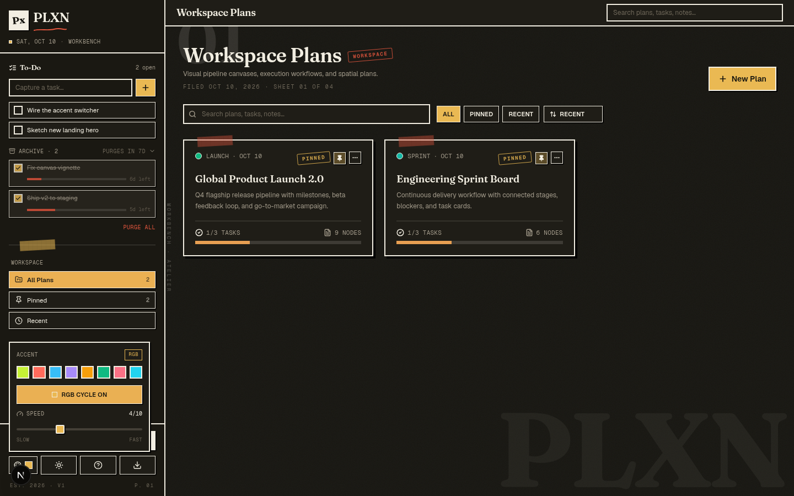

# PLXN ($P_x$)

A visual project planner and infinite canvas workspace with an editorial *Workbench / Atelier Brut* aesthetic — warm paper, ink-black borders, hard offset shadows, a single punchy accent, and a built-in To-Do list that archives and auto-purges itself.




## Overview

PLXN lets you map out complex projects spatially rather than getting lost in rigid tables or linear task lists. Arrange notes, tasks, checklists, and milestones on an infinite 2D canvas, link dependencies with directional flow lines, and track project execution progress in real time — all wrapped in a drafting-table UI with a persistent left Spine, a slim contextual Topbar, and a focused main area.


## Key Features

- **Infinite Spatial Canvas**: Freely pan, zoom (25%–250%), and snap nodes to a clean engineering grid. Corner registration marks and a live `x / y / zoom%` coordinate stamp keep you oriented.
- **MS Paint-Style Whiteboard Drawing**:
  - Tablet & stylus ready freehand pen with midpoint curve smoothing for fluid handwriting and drafting.
  - Basic geometric shapes: **Lines**, **Directional Arrows**, **Rectangles**, and **Circles/Ellipses** (with outline or translucent tint fill).
  - Continuous stroke eraser tool with brush-over deletion.
  - Curated color swatches + custom color picker, and 4 stroke weights (Fine, Medium, Bold, Marker).
  - Dedicated **Clear Drawings** action that wipes only drawings while keeping all project nodes, tasks, and connections intact.
  - Full Undo/Redo (`Ctrl+Z` / `Ctrl+Y`) integration for all strokes and shapes.
- **Node Ecosystem** (6 types, each a thick-bordered index card with a colored gradient accent bar):
  - **Text Boxes**: Freeform floating whiteboard text & annotations with typography controls (Sans, Serif, Mono, Handwriting), font sizes (S/M/L/XL/2XL), alignments, colors, and frameless or framed card modes.
  - **Tasks**: Checklists, assignees, due dates, statuses (*To-Do*, *In Progress*, *Done*), and live progress bars.
  - **Milestones**: Major goals, target dates, and phase status.
  - **Notes & Links**: Rich markdown-styled thoughts and external documentation references.
  - **Image**: URL or upload, with caption and curated sample presets.
- **Directional Connectors**: Link cards via 4 directional anchor ports with smooth bezier curves, editable inline labels, and one-click delete.
- **Workspace Dashboard**: Filter projects by tags, pinned items, or recent updates, with global search across all plans and cards.
- **Workflow Templates**: Quick-start blueprints including *Product Launch*, *Kanban Sprint*, *Sci-Fi Storyboard*, and *Weekly Focus*.
- **To-Do List with 7-Day Auto-Archive** *(new)*:
  - A dedicated checklist that lives in the left Spine, separate from your canvas projects.
  - Check an item off and it slides into an **Archive rail** with a struck-through card, a red-ink **decay bar** that fills as the week passes, and a live `Nd left` countdown.
  - Archived items **auto-purge after 7 days** — a sweep runs on load, on tab refocus, and every 30s.
  - Restore or delete manually at any time. Persists across reloads via `localStorage`.
- **Accent Switcher** *(new)*:
  - 8 preset accent colors (Lime, Coral, Sky, Violet, Amber, Emerald, Rose, Cyan).
  - **RGB Cycle mode** that rotates the accent through the full hue wheel live, with a 1–10 speed slider (Slow → Fast).
  - Switching the accent genuinely recolors the whole UI — active nav, checkboxes, primary buttons, selected-node rings, progress bars, rubber stamps, washi tape — via a single CSS variable.
- **Editorial Decoration**: Fraunces display serif for headings, faded giant "PLXN" wordmark behind the dashboard, "01" section numerals, "Filed / Sheet" stamps, corner registration marks, a vertical "Workbench · Atelier" edge label, and an "Est. 2026 · v1" footer stamp.
- **Offline-First & Local Profile**: Operates entirely client-side via `localStorage`. A lightweight local profile (name + optional email) replaces cloud auth — faithful to the app's offline-first design.
- **Dark & Light Mode**: Warm cream paper / warm ink dark, with instant zero-flash theme persistence and an adaptive dot-grid canvas.
- **Data Portability**: Full Undo/Redo history (`Cmd+Z` / `Cmd+Shift+Z`) and one-click JSON workspace export and import.


## Screenshots

<table>
  <tr>
    <td width="50%" align="center"><b>Dashboard — Light</b></td>
    <td width="50%" align="center"><b>Dashboard — Dark</b></td>
  </tr>
  <tr>
    <td></td>
    <td></td>
  </tr>
  <tr>
    <td width="50%" align="center"><b>Infinite Canvas — Light</b></td>
    <td width="50%" align="center"><b>Infinite Canvas — Dark</b></td>
  </tr>
  <tr>
    <td></td>
    <td></td>
  </tr>
  <tr>
    <td width="50%" align="center"><b>Accent Switcher — Presets</b></td>
    <td width="50%" align="center"><b>Accent Switcher — RGB Cycle</b></td>
  </tr>
  <tr>
    <td></td>
    <td></td>
  </tr>
</table>


## Tech Stack

- **Framework**: [Next.js 16](https://nextjs.org/) (App Router) + [React 19](https://react.dev/) + [TypeScript 5](https://www.typescriptlang.org/)
- **Styling**: [Tailwind CSS v4](https://tailwindcss.com/) + [shadcn/ui](https://ui.shadcn.com/) component primitives
- **Icons**: [Lucide React](https://lucide.dev/)
- **Display Type**: [Fraunces](https://fonts.google.com/specimen/Fraunces) (via `next/font/google`) for editorial headings
- **Persistence**: `localStorage` (projects, profile, tasks, accent, theme) — no server, no database


## Getting Started

### Prerequisites

- Node.js (v18 or higher)
- npm or bun

### Installation

```bash
# Clone the repository
git clone <repo-url>
cd plxn

# Install dependencies
npm install   # or: bun install

# Start local development server
npm run dev   # or: bun run dev
```

Visit `http://localhost:3000` in your browser.

### Building for Production (Static Export)

```bash
npm run build   # or: bun run build
```

This runs Next.js with `output: "export"` and produces a fully static site in the **`out/`** folder — a real `index.html` plus hashed assets in `out/_next/static/`. No Node server is required at runtime.


## Deployment

PLXN is a static export, so it deploys to any static host. Recommended free options:

| Host | Why |
|---|---|
| **Netlify** (recommended) | Drag-and-drop the `out/` folder, or connect a GitHub repo. Free tier: 100 GB bandwidth / 300 build minutes. |
| **Cloudflare Pages** | Unlimited bandwidth on the free tier. Connect a repo, set build `npm run build`, output dir `out`. |
| **Vercel** | Native Next.js host. Free tier generous for personal projects. |
| **GitHub Pages** | Free for public repos. Push `out/` to a `gh-pages` branch. |

### Netlify (quick start)

Drop a `netlify.toml` at the repo root:

```toml
[build]
  command = "npm run build"
  publish = "out"

[[redirects]]
  from = "/*"
  to = "/index.html"
  status = 200
```

Then either drag the `out/` folder onto Netlify's manual deploy page, or connect the repo for auto-deploys on every push.


## Project Structure

```
src/
  app/                    # Next.js App Router
    layout.tsx            # Root layout + Fraunces/Geist fonts
    page.tsx              # '/' route — dynamically imports the PLXN shell (ssr:false)
    globals.css           # Workbench theme system (brut shadows, rubber stamps, accent vars, …)
  plxn/
    App.tsx               # Shell: Spine + Topbar + Dashboard/Canvas
    types/                # Shared TypeScript types
    data/templates.ts     # The 4 starter project templates
    lib/nodeColors.ts     # Shared node color system (ink borders + accent bars)
    utils/                # Canvas math, drawing math, storage, safe-triangle
    hooks/useSafeHover    # Amazon safe-triangle hover hook
    context/              # ProjectContext, ProfileContext, TaskListContext, AccentContext
    components/
      Spine/              # Persistent left sidebar: brand, To-Do list, nav, tags, profile, actions
        Spine.tsx
        TaskList.tsx      # To-Do + 7-day auto-archiving archive rail
        AccentSwitcher.tsx
      Topbar.tsx          # Slim contextual top bar + global modals
      Dashboard/          # Project cards grid + New Project modal
      Canvas/             # Infinite canvas + toolbar + connections + minimap + side panel + drawing
        Nodes/            # NodeWrapper + 6 node types
      Modals/             # Shortcuts, Export/Import, Delete, Auth (local profile)
```


## Keyboard Shortcuts

| Action | Shortcut |
|---|---|
| New Text Box | `X` |
| New Note | `N` |
| New Task | `T` |
| New Milestone | `M` |
| New Link | `L` |
| Toggle Draw mode | `P` |
| Eraser | `E` |
| Pan canvas | `Space` + drag |
| Zoom (cursor-centered) | `Ctrl` + wheel |
| Zoom to fit all | `0` |
| Duplicate node | `Ctrl` + `D` |
| Delete selected | `Del` / `Backspace` |
| Undo / Redo | `Ctrl`+`Z` / `Ctrl`+`Y` |
| Deselect / dismiss | `Esc` |
| Quick-create Note | Double-click empty canvas |
| Connect nodes | Drag from a side port to another node |


## Attributes

*Initially built as a personal project for personal workflow / project planning. Reimagined with a Workbench / Atelier Brut visual identity, a persistent Spine layout, a self-archiving To-Do list, and a live accent switcher.*


## License

MIT
